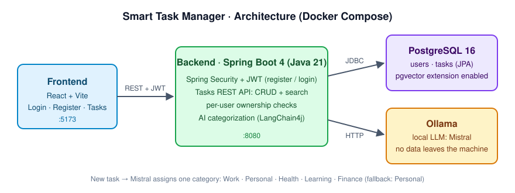

# Smart Task Manager with AI


Full-stack task manager with JWT authentication and **local AI categorization**: every new task is classified by a Mistral model running in Ollama, so no task data leaves the machine. Everything starts with one `docker compose up`.



## Features

- **Authentication:** registration and login with Spring Security, BCrypt and stateless JWT
- **Tasks REST API:** create, list, update, delete; every query is scoped to the logged-in user
- **Search:** case-insensitive search in title and description
- **AI categorization:** LangChain4j + Ollama (Mistral) assigns one of *Work, Personal, Health, Learning, Finance*; invalid or failed answers fall back to *Personal*, so the API never breaks because of the model
- **Frontend:** React + Vite with login, registration and a task board
- **One-command setup:** Docker Compose with PostgreSQL 16 (pgvector enabled for planned semantic search), backend, frontend and Ollama

## API

| Method | Endpoint | Auth | Description |
|---|---|---|---|
| POST | `/api/auth/register` | – | create a user, returns a JWT |
| POST | `/api/auth/login` | – | returns a JWT |
| GET | `/api/tasks` | JWT | list own tasks (newest first) |
| POST | `/api/tasks` | JWT | create a task, AI sets `category` |
| PUT | `/api/tasks/{id}` | JWT | update title, description or status |
| DELETE | `/api/tasks/{id}` | JWT | delete own task |
| GET | `/api/tasks/search?q=…` | JWT | search own tasks |

```bash
# example: create a task (token from /api/auth/login)
curl -X POST http://localhost:8080/api/tasks \
  -H "Authorization: Bearer $TOKEN" -H "Content-Type: application/json" \
  -d '{"title":"Book dentist appointment","description":"next week"}'
# → {"id":1,"title":"Book dentist appointment",...,"status":"OPEN","category":"Health"}
```

After the first `docker compose up`, pull the model once: `docker exec -it smt-ollama ollama pull mistral`.

---

## Table of contents

- [Features](#features)
- [API](#api)
- [Project structure](#project-structure)
- [Prerequisites](#prerequisites)
- [Quick start](#quick-start)
- [Environment configuration (.env)](#environment-configuration-env)
- [Run modes](#run-modes)
  - [Run everything (recommended)](#run-everything-recommended)
  - [Run database only](#run-database-only)
  - [Rebuild and restart](#rebuild-and-restart)
  - [Stop and reset](#stop-and-reset)
- [Access URLs](#access-urls)
- [Database access](#database-access)
- [Backend configuration notes](#backend-configuration-notes)
- [Frontend configuration notes](#frontend-configuration-notes)
- [Git hygiene / secrets](#git-hygiene--secrets)
- [Troubleshooting](#troubleshooting)
- [Roadmap](#roadmap)
- [License](#license)

---

## Project structure

```
smart-task-manager/
├── docker-compose.yml
├── .env.example
├── .gitignore
├── README.md
├── backend/                  # Spring Boot backend
│   ├── Dockerfile
│   ├── pom.xml
│   └── src/
└── frontend/
    └── ui/                   # React (Vite) frontend
        ├── Dockerfile
        ├── package.json
        └── src/
```

**Why Compose in the repo root?**  
Because it gives you **one entry point** to run the entire stack and keeps the developer experience consistent.

---

## Prerequisites

- **Docker Desktop** (Windows/macOS) or Docker Engine (Linux)
- Docker Compose (ships with Docker Desktop)
- Optional (for running without Docker):
  - Java 21
  - Maven
  - Node.js 20+

### Windows note (important)
This project uses Linux containers (e.g., `postgres:16`). On Windows, Docker Desktop should be running and set to **Linux containers**.

---

## Quick start

### 1) Create your local `.env`
Copy the example file and adjust values if you want:

**PowerShell**
```powershell
copy .env.example .env
```

**Bash**
```bash
cp .env.example .env
```

> `.env` is ignored by git and should never be committed.

### 2) Start everything
From the repo root:

```bash
docker compose up -d --build
```

### 3) Watch logs (recommended first run)
```bash
docker compose logs -f db
```

In another terminal:
```bash
docker compose logs -f backend
```

And (optional):
```bash
docker compose logs -f frontend
```

---

## Environment configuration (.env)

`docker compose` reads `.env` automatically and injects those variables into the containers.

### Example `.env.example`
```env
# PostgreSQL
POSTGRES_DB=smart_task_manager
POSTGRES_USER=smt_user
POSTGRES_PASSWORD=smt_dev_password

# Backend datasource (hostname is "db" inside the compose network)
SPRING_DATASOURCE_URL=jdbc:postgresql://db:5432/smart_task_manager
SPRING_DATASOURCE_USERNAME=smt_user
SPRING_DATASOURCE_PASSWORD=smt_dev_password

# Optional
SPRING_JPA_HIBERNATE_DDL_AUTO=update
SPRING_JPA_SHOW_SQL=false
```

### Notes on `POSTGRES_USER`
`POSTGRES_USER` is a **database user** created at container initialization and set as the owner of the DB.  
It is **not** an “admin user” of your application.

---

## Run modes

### Run everything (recommended)
```bash
docker compose up -d --build
```

### Run database only
```bash
docker compose up -d db
```

### Rebuild and restart
After changing `Dockerfile`, `pom.xml`, or `package.json`:
```bash
docker compose up -d --build
```

### Stop and reset

Stop containers:
```bash
docker compose down
```

Stop containers and **remove** persisted DB data (⚠️ deletes local dev DB):
```bash
docker compose down -v
```

---

## Access URLs

- Frontend: **http://localhost:5173**
- Backend: **http://localhost:8080**
- PostgreSQL: **localhost:5432** (from your host machine)

---

## Database access

### Connect from your host (DBeaver, pgAdmin, psql)
Use the values from your `.env`:

- Host: `localhost`
- Port: `5432`
- Database: `smart_task_manager`
- Username: `smt_user` (or your chosen user)
- Password: your chosen password

### Connect from inside containers
Inside the Compose network, the DB hostname is **`db`**.

---

## Backend configuration notes

### No SQL schema required (during early development)
The backend uses Spring Data JPA (Hibernate). If you set:
```env
SPRING_JPA_HIBERNATE_DDL_AUTO=update
```
then Hibernate can create/update tables automatically **when you add `@Entity` classes**.

- If there are no entities yet → no tables are created (this is normal).
- Later, for production-grade migrations, consider Flyway or Liquibase.

### Recommended production posture (later)
- Use `ddl-auto=validate` (or `none`)
- Run migrations with Flyway/Liquibase
- Use a real secret manager instead of `.env`

---

## Frontend configuration notes

### API calls
Recommended approach for development: call backend APIs via a relative path such as:
- `GET /api/...`

If you use Vite dev proxy, configure it in `frontend/ui/vite.config.js`:

```js
export default defineConfig({
  server: {
    proxy: {
      '/api': {
        target: 'http://backend:8080',
        changeOrigin: true,
      }
    }
  }
})
```

This avoids CORS friction during development.

---

## Git hygiene / secrets

✅ Good practices used in this repo:
- `.env` is gitignored (local secrets only)
- `backend/src/main/resources/application.properties` is gitignored
- `.env.example` is committed (safe template)

Do not commit:
- `.env`
- API keys / tokens
- passwords
- private SSH keys

---

## Troubleshooting

### “Cannot connect to Docker Desktop Linux engine”
Typical Windows error:
```
open //./pipe/dockerDesktopLinuxEngine: The system cannot find the file specified
```
Fix:
1) Start Docker Desktop
2) Ensure it runs **Linux containers**
3) Retry: `docker compose up -d --build`

### Backend fails with “Failed to configure a DataSource”
- Ensure `.env` exists
- Ensure `SPRING_DATASOURCE_URL` uses host `db` (not `localhost`) **inside Compose**
- Ensure Postgres service is healthy (`docker compose ps`)

### Reset everything
If something is stuck:
```bash
docker compose down -v
docker compose up -d --build
```

---

## Roadmap

Done:
- [x] Domain model `User`, `Task` with repositories and service layer
- [x] JWT authentication (register / login) and per-user task ownership
- [x] Tasks CRUD and search under `/api/tasks`
- [x] AI categorization with a local LLM (Ollama / Mistral)
- [x] React frontend: login, registration, task board

Next:
- [ ] Semantic search with embeddings in pgvector
- [ ] Integration tests with Testcontainers
- [ ] CI pipeline (GitHub Actions)
- [ ] Flyway migrations instead of `ddl-auto=update`
- [ ] Nginx reverse proxy for production

---

## License

This project is released under the **MIT License** (recommended for templates/starter repos).
